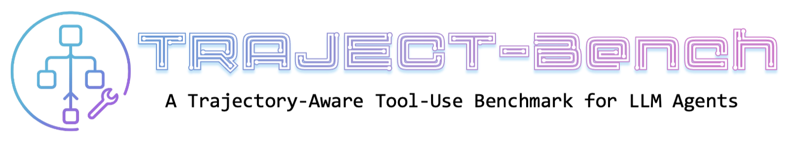
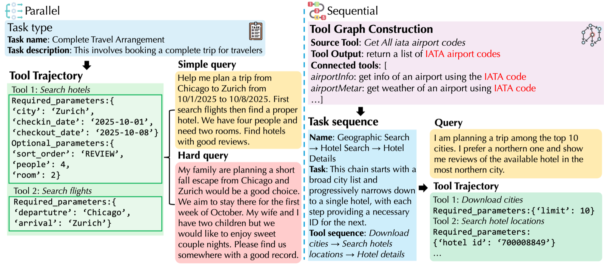
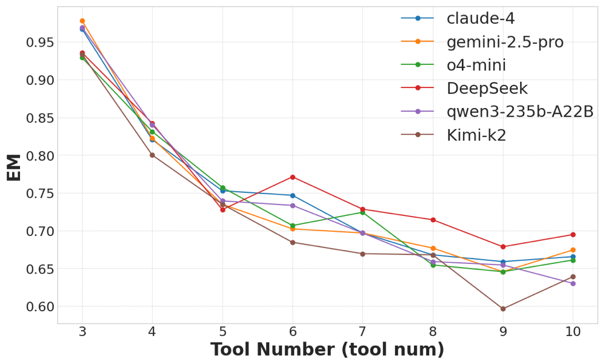
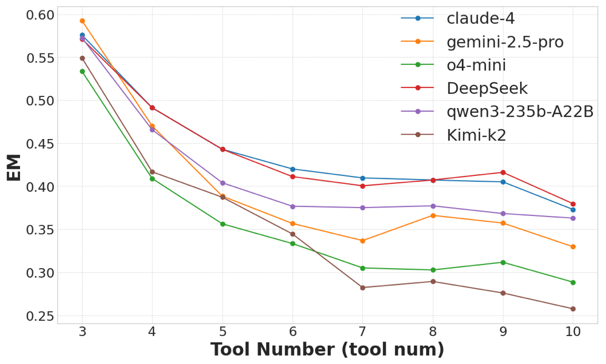

<div class="project-page" markdown="1">

<figure class="project-hero"></figure>

<div class="project-links">
  <a href="https://github.com/PengfeiHePower/TRAJECT-Bench" class="btn btn-sm z-depth-0" role="button"><i class="fab fa-github"></i> Code</a>
  <a href="https://huggingface.co/datasets/bigboss24/TRAJECT-Bench" class="btn btn-sm z-depth-0" role="button">🤗 Dataset</a>
  <a href="https://openreview.net/pdf?id=TZWnWvsQ0X" class="btn btn-sm z-depth-0" role="button"><i class="fas fa-file-pdf"></i> Paper</a>
  <br>
  
  
  
</div>

<div class="tldr">
<strong>TL;DR</strong> &mdash; Getting the final answer right is not enough. TRAJECT-Bench checks <em>how</em> an LLM agent uses tools: whether it picks the right tools, fills in the right arguments, and calls them in the right order.
</div>

<div class="stat-grid">
  <div class="stat"><span class="number">1,228</span><span class="label">executable tools</span></div>
  <div class="stat"><span class="number">5,670</span><span class="label">queries</span></div>
  <div class="stat"><span class="number">3&ndash;10+</span><span class="label">tools per trajectory</span></div>
  <div class="stat"><span class="number">2</span><span class="label">difficulty levels</span></div>
</div>

## Why trajectories?

Agents increasingly rely on tools to finish real-world tasks, yet most benchmarks only grade the final answer. An agent can land on the right answer with a broken process, or fail because of one wrong argument early in a long chain. TRAJECT-Bench makes the tool-use trajectory itself the object of evaluation.

<figure class="project-figure">
  
  <figcaption>Two kinds of trajectories. <strong>Parallel</strong> (left): a real task type such as travel booking is turned into a set of tool calls, then paired with a simple, explicit query and a hard, implicit one. <strong>Sequential</strong> (right): tools are chained through a tool graph, where each step's output feeds the next.</figcaption>
</figure>

## What's inside

<div class="feature-grid">
  <div class="feature"><div class="icon">🧰</div><h4>Production-style tools</h4><p>Over 1,000 high-fidelity, executable APIs across practical domains such as travel, finance, and music.</p></div>
  <div class="feature"><div class="icon">🔀</div><h4>Breadth and depth</h4><p>Parallel calls test breadth; interdependent sequential chains test depth.</p></div>
  <div class="feature"><div class="icon">🎯</div><h4>Simple vs. hard queries</h4><p>Every trajectory comes with an explicit query and an implicit one where the agent must infer the needed tools.</p></div>
  <div class="feature"><div class="icon">📏</div><h4>Trajectory-level metrics</h4><p>Exact match, tool inclusion, argument correctness, dependency and order satisfaction, plus final accuracy.</p></div>
</div>

## Key findings

<div class="finding"><div class="num">1</div><p><strong>Scaling tool use is a universal challenge.</strong> Performance drops for every model as trajectories get longer, and the sharpest drop is the step from short to mid-length trajectories.</p></div>
<div class="finding"><div class="num">2</div><p><strong>Implicit queries are hard.</strong> When the user does not name the steps, models struggle to infer which tools are needed, which causes cascading errors in selection and arguments.</p></div>
<div class="finding"><div class="num">3</div><p><strong>Recurring failure modes.</strong> Models confuse similar tools and select tools without checking whether their parameters fit the request.</p></div>
<div class="finding"><div class="num">4</div><p><strong>Retrieval is not a silver bullet.</strong> Retrieval-based tool selection helps little on simple queries and becomes a severe bottleneck on hard ones, while agentic methods such as ReAct with dynamic retrieval are more robust.</p></div>

<div class="figure-row">
  <figure class="project-figure">
    
    <figcaption>Exact match vs. number of tools on simple parallel queries.</figcaption>
  </figure>
  <figure class="project-figure">
    
    <figcaption>The same on hard queries. Claude-4 and DeepSeek degrade most gracefully.</figcaption>
  </figure>
</div>

## Get started

```bash
git clone https://github.com/PengfeiHePower/TRAJECT-Bench.git
cd TRAJECT-Bench
pip install -r requirements.txt
python evaluation/tool_evaluation_model.py -model claude_v37 -tool_select domain \
  -method direct -traj_type parallel -traj_file simple_ver
```

## Citation

```bibtex
@inproceedings{he2026traject,
  title     = {TRAJECT-Bench: A Trajectory-Aware Benchmark for Evaluating Agentic Tool Use},
  author    = {He, Pengfei and Dai, Zhenwei and He, Bing and Liu, Hui and Tang, Xianfeng and
               Lu, Hanqing and Li, Juanhui and Ding, Jiayuan and Mukherjee, Subhabrata and
               Wang, Suhang and Xing, Yue and Tang, Jiliang and Dumoulin, Benoit},
  booktitle = {International Conference on Learning Representations (ICLR)},
  year      = {2026}
}
```

</div>
