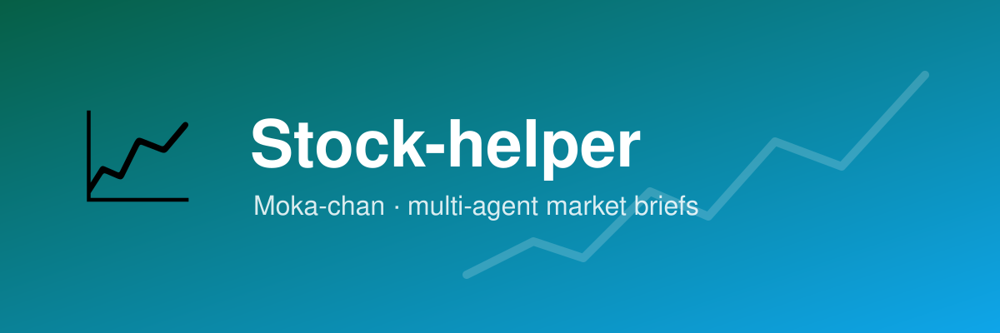

<figure class="project-hero"></figure>

  <a href="https://github.com/PengfeiHePower/Stock-helper" class="btn btn-sm z-depth-0" role="button"><i class="fab fa-github"></i> Code</a>
   
  
  
  

<strong>TL;DR</strong> &mdash; Meet <strong>Moka-chan</strong>, a team of LLM agents that reads the market news so I don't have to. She sends a brief before the open, a recap after the close, and a review every Friday, and pings me when something on my watchlist moves.

  
3scheduled briefs: morning, close, weekly

  
8layer CIO decision pipeline

  
30+industries tracked

  
中 / ENbilingual reports

## The agent pipeline

Every brief runs through a LangGraph pipeline of specialized agents:

  🌍 Macro→
  🏭 Sectors→
  📊 Stocks→
  🔍 Agent picks→
  ⚠️ Risk

The final brief is assembled in code in a fixed order, so it is never truncated by the LLM and always has the same structure.

## A trading day with Moka-chan

  

🌅
<h4>7:00 ET &middot; Morning brief</h4>
Pre-market snapshot, macro backdrop, sectors and stocks to watch, watchlist earnings, and star IPOs.

  

🔔
<h4>All day &middot; Real-time alerts</h4>
Telegram pings for SEC filings, material headlines, and watchlist price moves.

  

🌆
<h4>16:45 ET &middot; Close brief</h4>
Closing recap with a <em>Morning vs. Reality</em> section comparing the morning outlook with what actually happened.

  

📅
<h4>Friday &middot; Weekly review</h4>
Macro and tracking trends, sector rotation, and next week's earnings.

## Thinking long term

Beyond daily briefs, a **Market Reasoning Agent** writes monthly and biweekly reports that track hypotheses (hold, weaken, invalidated) with evidence scores. A **CIO Investment Agent** then turns the analysis into an allocation view through an eight-layer pipeline:

  Regime→
  Theme→
  Industry→
  Stock→
  Portfolio→
  Scenario→
  Triggers→
  Monitor

Each layer follows an *evidence → hypothesis → counter-argument → decision* pattern.

## Under the hood

Data comes from Finnhub (news, quotes, earnings and IPO calendars), SEC EDGAR filings, and FRED macro series. Models are routed by cost: Gemini Flash-Lite classifies news, and Claude Sonnet writes the analysis, with a per-run budget tracker. Briefs go out through Telegram and HTML email, and Moka-chan also chats in Chinese or English with persistent memory.

